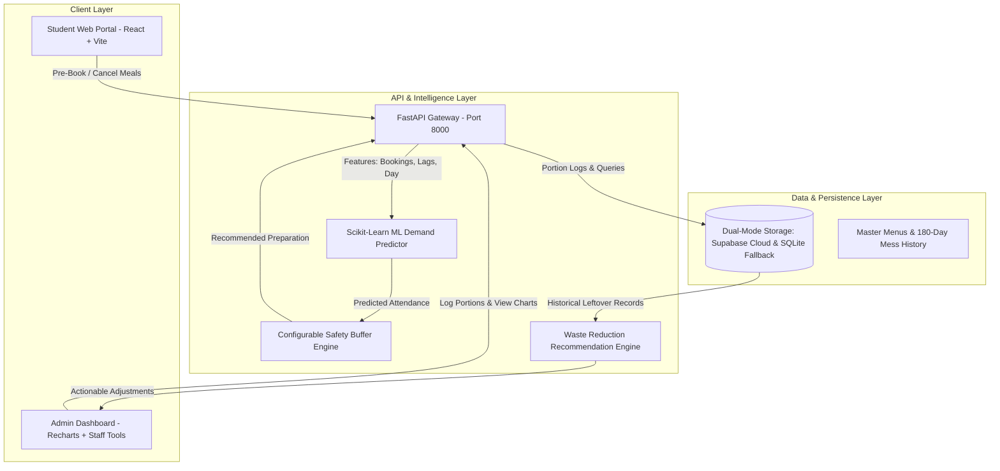

# AI-Powered Smart Mess Meal Pre-Booking & Food Waste Reduction Agent

> **A Full-Stack College Mini Project & Hackathon Demonstration**  
> Developed for college hostel mess management to minimize food waste while ensuring high student meal satisfaction.

[](https://react.dev/)
[](https://fastapi.tiangolo.com/)
[](https://scikit-learn.org/)
[](https://supabase.com/)
[](LICENSE)

---

## 1. Executive Summary & Objective

In typical college hostels and institutional dining facilities, mess managers cook food based on static assumptions or rough student counts. This frequently results in **15% to 25% food wastage** due to unpredicted absenteeism, weekend travel, exam schedules, and unpopular menu items.

The **AI-Powered Smart Mess System** transforms dining management through a closed-loop sustainability workflow:
$$\text{Book} \longrightarrow \text{Predict} \longrightarrow \text{Prepare} \longrightarrow \text{Measure} \longrightarrow \text{Analyze} \longrightarrow \text{Improve}$$

1. **Book**: Students pre-book meals ahead of cutoff timings with strict duplicate booking prevention.
2. **Predict**: Machine learning models forecast realistic turnout demand using historical attendance patterns and day factors.
3. **Prepare**: Kitchen staff receive exact preparation quotas with a configurable safety buffer (e.g., +8%) to avoid shortfalls without over-cooking.
4. **Measure**: Mess administrators record actual prepared, served, and dish-wise leftover portions.
5. **Analyze**: Interactive data analytics visualize waste percentages across meals, individual dishes, and daily trends.
6. **Improve**: Actionable AI recommendations automatically adjust future batch sizes and buffer sizes for high-waste dishes.

---

## 2. System Architecture



---

## 3. Technology Stack

| Layer | Technologies Used | Description |
| :--- | :--- | :--- |
| **Frontend** | React 19, Vite 8, Vanilla CSS, Lucide React, Recharts | Fast, modern mobile-first dashboard with green-and-white aesthetic, interactive sliders, and animated charts. |
| **Backend** | Python 3.13, FastAPI, Pydantic, Uvicorn | High-performance asynchronous REST API with strict request validation and error handling. |
| **AI / Machine Learning** | Scikit-learn, Pandas, NumPy, Joblib | Ridge Regression pipeline with standard feature scaling, one-hot encoding, and explainable feature weights. |
| **Database** | Supabase PostgreSQL & SQLite | Dual-mode architecture: connects to Supabase cloud when credentials exist, with zero-config local persistence for offline reliability. |
| **Testing** | Pytest, HTTPX, FastAPI TestClient | 12 automated integration tests validating bookings, duplicate blocks, ML predictions, and analytics. |

---

## 4. Key Features

### Student Portal
- **Smart Mess Dashboard**: Visual meal cards featuring custom meal graphics, timings, and dietary details.
- **Meal Timings**:
  - **Breakfast**: 7:00 AM – 8:45 AM
  - **Lunch**: 12:15 PM – 1:30 PM
  - **Dinner**: 7:00 PM – 8:45 PM
- **Date Selector**: Select today or upcoming dates with interactive day pills.
- **Booking Flow with Confirmation**: Pre-book meals with transparent modal confirmation.
- **Duplicate Prevention**: System enforces strict uniqueness `(student_id, date, meal_type)` blocking duplicate meal bookings with clear alerts.
- **My Bookings & Cancellation**: View all reserved meals with one-click cancellation dialog.
- **AI Insights Explorer**: Interactive page explaining turnout forecasts and letting students explore how safety buffers protect against shortages.
- **Student Profile**: Shows hostel room, department (ECE), dietary preferences, and personal food saved impact badge.

### Administrator & Kitchen Portal
- **Role-Protected Access**: Staff portal protected by password authorization (Administrator Password: `hellomini`).
- **Overview & Daily Quotas**: Live booking counts, predicted demand, and recommended preparation quantities.
- **Portion & Food Tracking**: Input prepared and served portions with automatic calculation of leftovers and waste percentages.
- **Dish-Wise Waste Recording**: Track individual leftovers for dishes (Steamed Rice, Sambar, Vegetable Poriyal, Curd, etc.).
- **Food Waste Analytics (Recharts)**:
  - Waste percentage by dish (highlights problematic dishes).
  - Daily waste trend comparison (prepared vs served vs leftovers).
  - Pre-booked vs predicted demand vs actual attendance.
  - Pie breakdown across Breakfast, Lunch, and Dinner.
- **Actionable AI Recommendations**: Continuous learning system flagging dishes exceeding waste thresholds with exact batch adjustments.

---

## 5. Mathematical Formulations

### 1. Leftover Portions
$$\text{Leftover Portions} = \max(0, \; \text{Prepared Portions} - \text{Served Portions})$$

### 2. Waste Percentage
$$\text{Waste Percentage} = \begin{cases} 
\left(\dfrac{\text{Leftover Portions}}{\text{Prepared Portions}}\right) \times 100 & \text{if } \text{Prepared Portions} > 0 \\ 
0\% & \text{otherwise} 
\end{cases}$$

### 3. Preparation Recommendation with Safety Buffer
$$\text{Recommended Preparation} = \left\lceil \text{Predicted Attendance} \times (1 + \text{Safety Buffer}) \right\rceil$$
*Where $\text{Safety Buffer} \in [0.03, 0.20]$ (default: $0.08$ or $8\%$).*

---

## 6. Machine Learning Model & Dataset Details

### Clearly Labeled Dataset
Because institutional historical mess logs vary between colleges, this project includes a synthetic dataset generator ([backend/ml/data_generator.py](backend/ml/data_generator.py)) simulating **180 days of college mess history** (540 meal records) for a 450-student hostel block. Each record is explicitly documented as synthetic training data.

### Features Utilized:
- `booking_count`: Pre-booked student slots.
- `prev_week_attendance`: Attendance for the same meal 7 days ago.
- `prev_day_attendance`: Attendance yesterday for the same meal.
- `is_weekend`: Flag indicating weekend turnout drops.
- `is_exam_period`: Flag indicating altered study/dining routines.
- `is_special_menu`: Flag for festival or Sunday feast attendance surges.
- `meal_type`: One-Hot Encoded (Breakfast, Lunch, Dinner).

### Evaluation Metrics (Empirically Computed):
- **Algorithm**: Ridge Regression with Scaled Feature Pipeline (`StandardScaler` + `OneHotEncoder`)
- **Train MAE**: 7.91 portions
- **Test MAE**: 7.51 portions
- **Test RMSE**: 9.76 portions
- **Test $R^2$ Score**: **0.9794** (strong correlation with true turnout)

---

## 7. Installation & Quick Start

### Prerequisites
- **Node.js** (v18.0 or higher) & `npm`
- **Python** (v3.10 or higher) & `pip`
- **Git**

### Step 1: Clone Repository
```bash
git clone https://github.com/helenavince/AI-Meal-System.git
cd AI-Meal-System
git checkout feature/smart-mess-ai
```

### Step 2: Backend Setup
```bash
# Install Python dependencies
pip install -r backend/requirements.txt

# Generate synthetic dataset and train ML model
python -m backend.ml.train

# Start FastAPI backend server
python -m uvicorn backend.main:app --host 127.0.0.1 --port 8000 --reload
```
The backend API is now running at `http://127.0.0.1:8000`. You can inspect interactive Swagger documentation at `http://127.0.0.1:8000/docs`.

### Step 3: Frontend Setup
In a new terminal window:
```bash
# Install Node dependencies
npm install

# Start Vite development server
npm run dev
```
Open `http://localhost:5173` in your browser.

---

## 8. Database Setup: Supabase Cloud vs Local Mode

The backend operates in **Dual-Storage Mode**:

### Option A: Zero-Config Local Mode (Default & Demonstration Ready)
If no Supabase credentials are configured, the system automatically uses SQLite (`backend/smart_mess.db`). It automatically runs migrations, seeds master menus, student profiles, and historical records. No configuration needed!

### Option B: Supabase PostgreSQL Cloud Mode
1. Create a free project at [supabase.com](https://supabase.com).
2. Open the **SQL Editor** in your Supabase dashboard and execute the script in [supabase_schema.sql](supabase_schema.sql).
3. Copy `.env.example` to `.env`:
   ```bash
   cp .env.example .env
   ```
4. Fill in your Supabase credentials:
   ```env
   SUPABASE_URL=https://your-project-id.supabase.co
   SUPABASE_KEY=your-supabase-service-role-or-anon-key
   ```
5. Restart the backend. The API will now persist records directly to Supabase cloud.

---

## 9. Running Verification & Automated Tests

Run the complete test suite verifying all 12 backend endpoints, duplicate blocking, ML predictions, and analytics:

```bash
python -m backend.test_api
```

Expected output:
```text
--- 1. Testing Health Check ---
[PASS] Health check OK: {'status': 'healthy', 'service': 'Smart Mess AI Backend'}

--- 2. Testing Menus ---
[PASS] Retrieved 3 meal menus: ['Breakfast', 'Lunch', 'Dinner']

--- 3. Testing Student Profile ---
[PASS] Retrieved student profile: Supriya (ECE2023045)

--- 4. Testing Meal Booking & Duplicate Prevention ---
[PASS] Booking created successfully: bkg_9c304ba45300
[PASS] Duplicate booking successfully blocked with HTTP 400

--- 5. Testing Student Bookings Query ---
[PASS] Verified booking present in student bookings list

--- 6. Testing Cancellation Flow ---
[PASS] Booking cancelled successfully

--- 7. Testing AI Demand Prediction ---
[PASS] AI Prediction: Booked: 420 -> Predicted Demand: 403 -> Recommended Prep: 436

--- 8. Testing Admin Summary ---
[PASS] Admin Summary verified

--- 9. Testing Preparation Logging ---
[PASS] Prep Log recorded: Prepared: 410, Served: 385, Leftover: 25, Waste: 6.1%

--- 10. Testing Dish-wise Waste Tracking ---
[PASS] Recorded dish-wise waste successfully

--- 11. Testing Waste Analytics Dashboard Data ---
[PASS] Waste Analytics fetched: Overall Waste: 9.0%

--- 12. Testing ML Model Metrics ---
[PASS] Model Metrics verified: MAE: 7.51, R2: 0.9794

==============================================
ALL 12 BACKEND & ML TESTS PASSED CLEANLY!
==============================================
```

To validate the frontend build:
```bash
npm run build
```

---

## 10. Demonstration Guide for Hackathons & Evaluators

### Part 1: Student Workflow
1. Navigate to `http://localhost:5173/`.
2. Notice the green-and-white theme, breakfast/lunch/dinner timings, and horizontal date picker.
3. Select tomorrow's date and click **Book** on **Breakfast**.
4. Review the confirmation dialog showing meal name, date, and timing. Confirm booking.
5. Notice the Breakfast card updates to **✓ Pre-Booked** and disables duplicate booking.
6. Navigate to the **Bookings** tab at the bottom to see your active reservation.
7. Click **Cancel** and confirm to demonstrate the cancellation flow.
8. Navigate to the **AI** tab to test the interactive safety buffer slider and review model metrics ($R^2 = 0.9794$).

### Part 2: Administrator & Food Waste Workflow
1. Click **Admin Login** in the top right header.
2. Enter password **`hellomini`** to authorize staff access.
3. In **Overview & Bookings**, observe the total confirmed bookings, AI predicted attendance, and recommended prep portions.
4. Click **Record Food & Waste** to simulate logging today's lunch:
   - Enter prepared portions (e.g. 410) and served portions (e.g. 385).
   - Enter dish-wise portions for Steamed Rice, Sambar, etc.
   - Click **Save Service Record**.
5. Switch to **Waste Analytics** to inspect the 4 live Recharts graphs:
   - Bar chart of waste by dish.
   - Line chart of daily prepared vs served trends.
   - Comparison chart of pre-booked vs predicted demand vs actual turnout.
   - Pie breakdown of waste across meals.
6. Open **AI Recommendations** to review continuous learning suggestions (e.g., reducing preparation for dishes exceeding waste thresholds).
7. Click **Exit Admin** to return to the student portal.

---

## 11. Project Directory Structure

```text
AI-Meal-System/
├── backend/
│   ├── data/
│   │   └── synthetic_mess_history.csv  # 180-day college mess dataset
│   ├── ml/
│   │   ├── data_generator.py           # Statistically grounded data generator
│   │   ├── train.py                    # Scikit-learn training pipeline
│   │   ├── predictor.py                # Inference service with safety buffer
│   │   ├── demand_model.joblib         # Serialized ML model
│   │   └── model_metrics.json          # MAE, RMSE, R2, feature weights
│   ├── database.py                     # SQLite & Supabase persistence layer
│   ├── main.py                         # FastAPI application & endpoints
│   ├── models.py                       # Pydantic validation schemas
│   ├── test_api.py                     # 12 automated API tests
│   └── requirements.txt                # Python dependencies
├── src/
│   ├── App.jsx                         # Main React application
│   ├── App.css                         # Green-and-white design system
│   ├── api.js                          # API client with offline fallback
│   ├── main.jsx                        # React root entry
│   └── index.css                       # Base stylesheet
├── supabase_schema.sql                 # Production PostgreSQL schema
├── .env.example                        # Environment variables template
├── package.json                        # Frontend packages & scripts
├── vite.config.js                      # Vite bundler configuration
└── README.md                           # Documentation & Demo Guide
```

---

## 12. Authors & Acknowledgments

- **Developed by**: Third-Year ECE Students (Supriya, Helena Vince)
- **Project**: College Mini Project & Hackathon Entry
- **Mentorship**: Central Mess Committee & Department of Electronics and Communication Engineering
